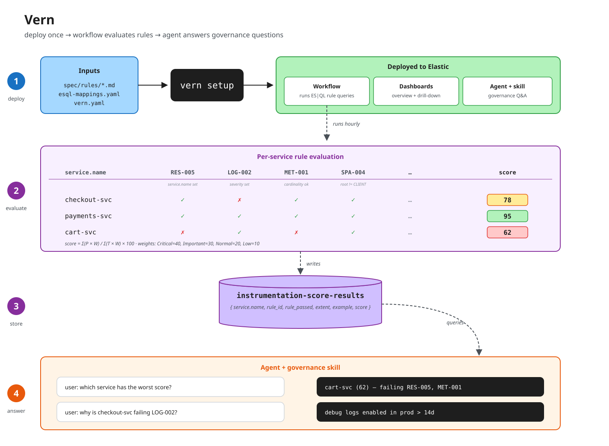
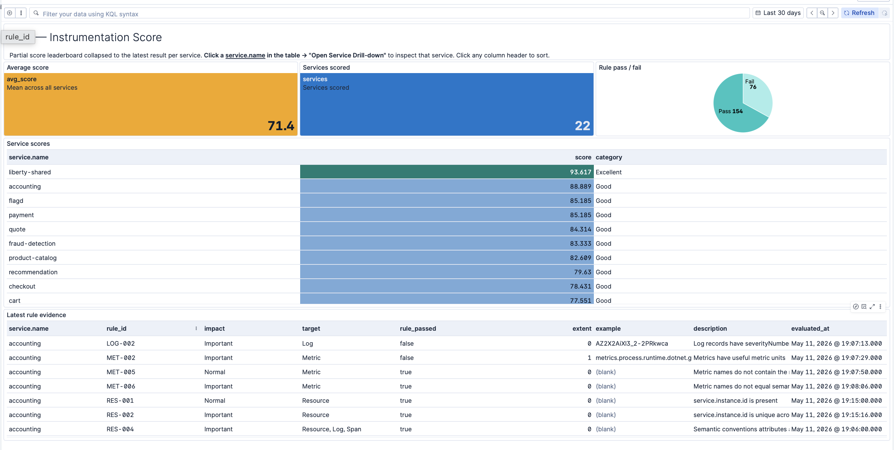
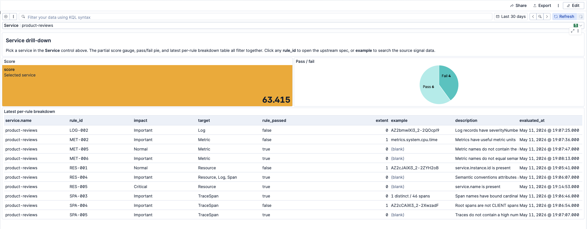
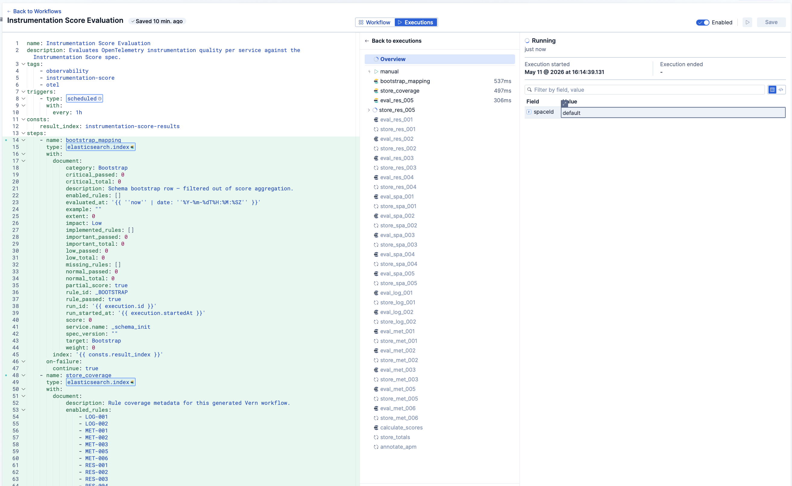
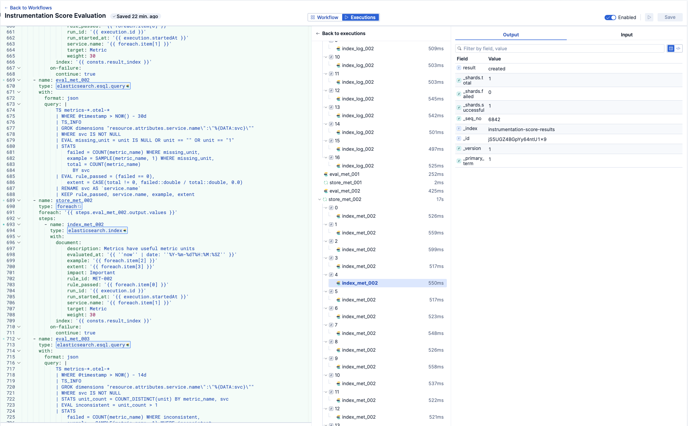
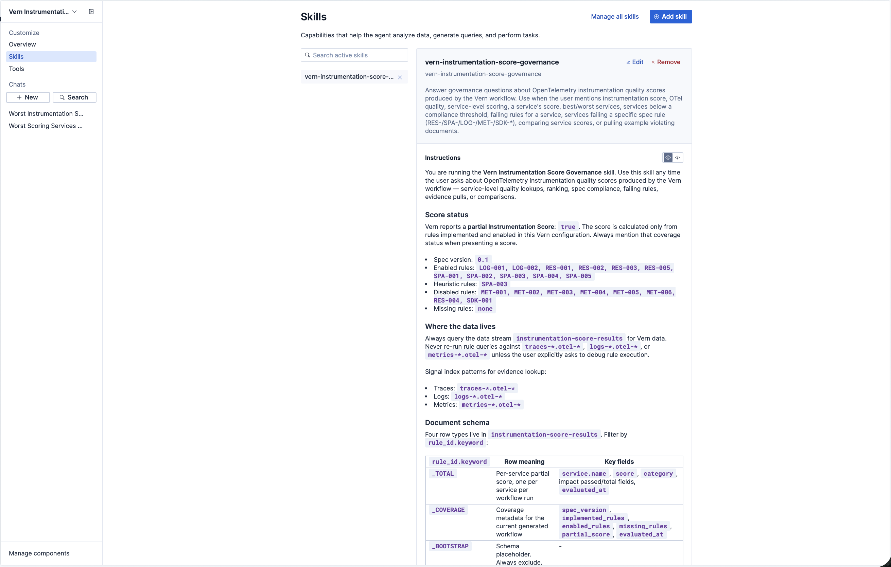
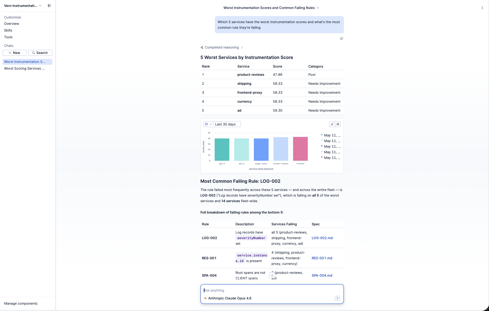
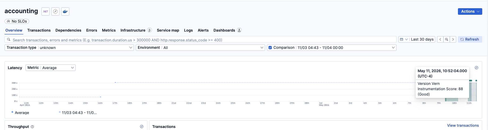

# vern

Vern is a Go CLI that scores OpenTelemetry instrumentation against the
[Instrumentation Score spec](https://github.com/instrumentation-score/spec).
It scores OTLP captures on a self-managed Elasticsearch (locally, in a web UI,
or in CI), evaluates rules against a live Elastic, ClickHouse or OpenSearch
backend, and deploys a scheduled evaluator to Elastic Serverless: an Elastic
Workflow, Kibana dashboards, and an Agent Builder assistant that queries the
score data.

<p align="center">
  
</p>

> Diagram source: [`docs/images/pipeline.excalidraw`](docs/images/pipeline.excalidraw) (open at [excalidraw.com](https://excalidraw.com)).

Vern emits a per-service Instrumentation Score (0 to 100) from the enabled
rules. Disabled and heuristic rules are reported as coverage metadata, and
advisory rules are shown but not scored.

## Score an OTLP capture

- `vern score capture.jsonl.gz` loads OTLP JSON captures (files, or `-` for
  stdin) into a self-managed Elasticsearch 9.5+, scores that run's data only,
  writes `vern-report.json` and `vern-report.md`, and deletes the data.
- It needs `VERN_ELASTICSEARCH_URL`, plus `VERN_API_KEY`, `VERN_API_KEY_FILE`
  or `VERN_ELASTICSEARCH_USERNAME`/`_PASSWORD` when security is on.
- A failed sensitive-data rule query logs only a fixed reason on stderr.
  `--debug` (or `VERN_DEBUG=true`) logs the full Elasticsearch error, which
  can quote field and metric names from the sample. Keep it off where stderr
  is shared, such as a public CI log.
- For a local cluster, see [`deploy/README.md`](deploy/README.md): `make up`,
  then `make score SAMPLE=path/to/capture.jsonl.gz`.
- `make up` also starts `vern serve`, a local web UI at http://127.0.0.1:8080
  where you drop OTLP files to score them, with the same scoring as an HTTP API
  (`POST /api/v1/runs`). Nothing is stored. It scores one upload at a time by
  default; see [limits and settings](deploy/README.md#local-ui-and-api).
- To host `vern serve` publicly, on Cloud Run or any VM, see
  [`docs/DEPLOY.md`](docs/DEPLOY.md).

## Score a sample in CI

A composite GitHub Action (`ericmustin/vern`) and a GitLab template run
`vern score` on committed captures, gate on `--min-score`, and can export the
score over OTLP. See [`docs/CI.md`](docs/CI.md) for usage and
[`docs/DEMO.md`](docs/DEMO.md) for an end-to-end walkthrough.

## Deploy to Elastic Serverless

```bash
make install                                                # → ~/.local/bin/vern
export KIBANA_URL=https://<your-project>.kb.<region>.elastic.cloud
export KIBANA_API_KEY=<base64-api-key>
vern setup --replace
```

`vern setup` reviews coverage, generates `workflows.yaml`, `dashboards.ndjson`
and `agent-skill.md`, uploads the workflow, imports the dashboards, and
registers the Agent Builder skill and agent. Add `--dry-run` to preview without
changing anything.

## Evaluate against a backend

`vern evaluate` runs the rules against a query backend and writes JSON and
Markdown reports. It needs only a query API and read access.

```bash
export VERN_CLICKHOUSE_URL=http://localhost:8123
export VERN_CLICKHOUSE_USERNAME=default
export VERN_CLICKHOUSE_PASSWORD=secret
vern evaluate --backend clickhouse
```

This loads `configs/clickhouse-mappings.yaml`, runs each rule against
ClickHouse, computes the score, and writes `vern-report.json` and
`vern-report.md`.

| Backend | DSL | Endpoint | Mappings file |
|---|---|---|---|
| `elastic` (alias `esql`) | ES\|QL | `POST /_query?format=json` | `configs/esql-mappings.yaml` |
| `clickhouse` | ClickHouse SQL | `POST /?default_format=JSONEachRow` | `configs/clickhouse-mappings.yaml` |
| `opensearch` | PPL | `POST /_plugins/_ppl?format=json` | `configs/opensearch-mappings.yaml` |

Credential env vars (`vern.yaml` values win when set):

| Backend | URL | User | Secret |
|---|---|---|---|
| elastic | `VERN_ELASTICSEARCH_URL` | `VERN_ELASTICSEARCH_USERNAME` (used only when no API key is set) | `VERN_API_KEY` (also `ELASTIC_API_KEY` / `KIBANA_API_KEY`); without an API key, `VERN_ELASTICSEARCH_PASSWORD` for basic auth |
| clickhouse | `VERN_CLICKHOUSE_URL` | `VERN_CLICKHOUSE_USERNAME` | `VERN_CLICKHOUSE_PASSWORD` |
| opensearch | `VERN_OPENSEARCH_URL` | `VERN_OPENSEARCH_USERNAME` | `VERN_OPENSEARCH_PASSWORD` |

**Rule coverage by backend.** `configs/esql-mappings.yaml` maps all 26 rules
(see [Rule coverage](#rule-coverage)). `clickhouse-mappings.yaml` and
`opensearch-mappings.yaml` cover 6: RES-005, RES-001, SPA-003, LOG-002,
MET-001 and MET-006, which span the Critical, Important and Normal tiers and
all three signals.

**Sensitive-data rules (RES-010, SPA-006, LOG-003, MET-008).** They scan the
fields discovered in each run, so they run only under `vern score` and
`vern serve`. `generate` (and `setup`) leaves them out of the workflow and
lists them as disabled in the coverage document and the agent skill;
`evaluate` reports them `not_assessable` ("needs per-run field discovery: run
vern score or vern serve").

Detection is heuristic: pattern-based, an open-ended list, and credit card
numbers are matched by brand prefix and length with no Luhn check. Matched
values are redacted before they reach any report, API body, log or the UI. An
ordinary rule's example that matches a detector is replaced with
`example withheld: it matches <label>`, and a `service.name` that matches is
shown as `service-N (name withheld: matches <label>)` in every output.

Blind spots (keyword values over 1024 characters, truncation, field caps,
dropped metric names, unstored metric descriptions and exemplar attributes,
out-of-window span events and log records) are listed in the report. Two are
not counted: malformed values under ECS-typed keys (for example a non-IP
string under `*.ip`, or `*.timestamp`), which read as null to ES|QL, and
attributes beyond Elasticsearch's 1,000-field mapping limit. Span events are
told apart from log records by the missing `observed_timestamp` that
Elasticsearch's native OTLP ingest writes on log records.

**ES|QL version.** `vern evaluate` and `vern generate` start every ES|QL rule
query with `SET unmapped_fields="nullify";`, so fields missing from your data
read as null instead of failing the query. This needs Elasticsearch 9.5+ (or
Serverless); on older clusters set `esql.unmapped_fields: off` in `vern.yaml`.

## What Vern creates in Kibana

### Overview dashboard

Service score leaderboard, average score across services, pass/fail pie, and a
latest-rule-evidence table. Click `service.name` → "Open Service Drill-down".



### Drill-down dashboard

Per-service score gauge, pass/fail pie, and the full per-rule breakdown with
links back to the spec rule and the underlying signal documents.



### Elastic Workflow

One Workflow named "Instrumentation Score Evaluation" runs on the configured
schedule. Each rule becomes an `elasticsearch.esql.query` step plus a
`foreach` indexer that writes results to `instrumentation-score-results`.



The execution view shows each rule's eval and store steps with timings and
output documents.



### Agent Builder skill and agent

The skill (`vern-instrumentation-score-governance`) embeds the result-document
schema, signal index patterns, and rule status, so the agent does not have to
rediscover them each turn.



The agent ranks services, surfaces the most common failing rule, and links
back to the spec.



### APM annotation

Each workflow run writes a Kibana annotation tagged `Version: Vern` with the
latest score. It appears as a hover marker on APM service overview charts.



## Rule coverage

| Rule | Target | Impact | Status | Notes |
|---|---|---|---|---|
| `RES-001` | Resource | Normal | Enabled | `service.instance.id` is present |
| `RES-002` | Resource | Important | Enabled | `service.instance.id` is unique across logical resources |
| `RES-003` | Resource | Important | Enabled | `k8s.pod.uid` is present for Kubernetes telemetry |
| `RES-004` | Resource, Log, Span | Important | Enabled | Narrow tripwire for misplaced `service.version` (ES\|QL schema-strict; widen per environment) |
| `RES-005` | Resource | Critical | Enabled | `service.name` is present |
| `SPA-001` | Span | Normal | Enabled | Limited number of `INTERNAL` spans per service |
| `SPA-002` | Span | Normal | Enabled | Parent span ids exist in the same trace |
| `SPA-003` | Span | Important | Advisory | Span-name cardinality heuristic; upstream criteria is TODO, so it is shown but not scored |
| `SPA-004` | Span | Important | Enabled | Root spans are not `CLIENT` spans |
| `SPA-005` | Span | Important | Enabled | Traces do not contain many short-duration spans |
| `LOG-001` | Log | Important | Enabled | Debug logs not enabled in production > 14 days |
| `LOG-002` | Log | Important | Enabled | Log records have severity set |
| `MET-001` | Metric | Important | Heuristic | Per-(metric, service) time-series count vs cardinality threshold |
| `MET-002` | Metric | Important | Enabled | Units are set (not NULL / empty); UCUM validity is not checked |
| `MET-003` | Metric | Important | Enabled | One unit per metric name across all services (no unit counts as a distinct unit); every service emitting a conflicting metric fails |
| `MET-004` | Metric | Normal | Disabled | Histogram bucket boundaries not exposed by `TS_INFO`/`METRICS_INFO` |
| `MET-005` | Metric | Normal | Enabled | Metric names don't contain a unit suffix |
| `MET-006` | Metric | Important | Enabled | Metric names don't equal a semconv attribute key |
| `MET-007` | Metric | Normal | Enabled | Metrics do not carry volatile or verbose resource attributes |
| `RES-006` | Resource | Normal | Enabled | `service.criticality` uses the canonical form of its well-known values |
| `RES-007` | Resource | Important | Enabled | `deployment.environment.name` is present |
| `SDK-001` | SDK | Low | Opt-in | Enable via `filters.enable_sdk_rules`; depends on vendored support matrix |
| `RES-010` | Resource | Critical | Heuristic | Pattern-based sensitive-data detection in resource attribute values (`vern score`/`vern serve`); matches are redacted, blind spots disclosed |
| `SPA-006` | Span | Critical | Heuristic | Same detection over span names, status messages, span and span event attributes |
| `LOG-003` | Log | Critical | Heuristic | Same detection over log bodies and attributes |
| `MET-008` | Metric | Critical | Heuristic | Same detection over metric names, units and data point attributes |

**26 rules: 24 enabled (6 heuristic: MET-001, SPA-003, RES-010, SPA-006, LOG-003, MET-008; SPA-003 is advisory) · 1 opt-in · 1 disabled · 0 missing.**

## Config

Default config lives in `vern.yaml`. Key settings:

```yaml
backend: esql
rules_dir: ./spec/rules
mappings: ./configs/esql-mappings.yaml

esql:
  time_window: "30d"
  index_patterns:
    traces: "traces-*.otel-*"
    metrics: "metrics-*.otel-*"
    logs: "logs-*.otel-*"
  result_index: "instrumentation-score-results"
  schedule: "1h"
  cardinality_threshold: 10000

filters:
  environments: []          # e.g. ["prod"]; appended as an AND predicate to every rule
  service_namespaces: []
  enable_sdk_rules: false   # turn on SDK-001

spec:
  upstream_repo: "instrumentation-score/spec"
  upstream_ref: "main"

semconv:
  upstream_repo: "open-telemetry/semantic-conventions"
  upstream_ref: "v1.37.0"
```

Defaults target native OTel ingest in Elastic Serverless. For legacy Elastic
APM data streams, edit index patterns and field paths in
`configs/esql-mappings.yaml`.

## More

- [docs/ADVANCED.md](docs/ADVANCED.md): Elastic deployment commands and flags,
  config reference, demo stack, development, and release.
- [agent-skill.md](agent-skill.md): the exact markdown Vern uploads to Agent
  Builder.

## Acknowledgments

Vern builds on prior work from:

- [chit786/instrumentation-score](https://github.com/chit786/instrumentation-score), a reference Go CLI for the spec
- [elastic/ai-github-actions-playground](https://github.com/elastic/ai-github-actions-playground), AI tooling patterns for Elastic
- Alexander Wert's [Instrumentation Score blog post](https://www.elastic.co/observability-labs/blog/otel-instrumentation-score)
  on Elastic Observability Labs, the motivating writeup for the score

## License

[MIT](./LICENSE) © Eric Mustin
